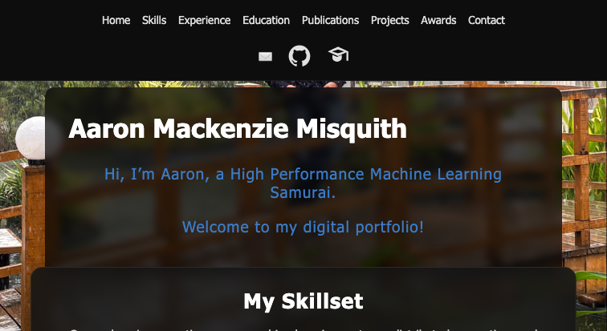

# Portfolio

The source of Aaron Mackenzie Misquith's personal portfolio site: research engineering, distributed machine learning, publications and projects, in one scrolling page.

Live site: https://aaronmackenzie.github.io/Portfolio/



## What the page contains

| Section | What it shows |
|---|---|
| Home | Name, tagline and a photo header. A short intro video plays first and fades out. |
| Skills | Seven skill groups with short descriptions. Six of them have a radar chart of proficiency. |
| Experience | Research and industry roles on a vertical timeline, with expandable details. |
| Education | Degree, coursework and final-year project. |
| Publications | Papers, patent filings and conference papers, with links to the PDFs. |
| Projects | Eight research and systems projects, plus a scrolling gallery of project images. |
| Awards | Honours and service roles. |
| Contact | Email, GitHub and Google Scholar. |

## How it is built

A static site with no build step and no framework: one `index.html`, one `style.css` and one `script.js`.

- **Radar charts** use [Chart.js 4.4.1](https://www.chartjs.org/), loaded from the cdnjs CDN. They draw when the Skills section scrolls into view.
- **Navigation** highlights the current section as you scroll.
- **Timeline** line position is recalculated on resize.
- **Gallery** is a looping marquee. `script.js` holds the list of 23 image names and adds each twice for a seamless loop (46 images on the page).
- **Intro** is `Media/Intro.mp4`, shown full screen while the page scroll is locked.

## Run it locally

```bash
git clone https://github.com/AaronMackenzie/Portfolio.git
cd Portfolio
python3 -m http.server 8000
```

Then open http://localhost:8000. Opening `index.html` directly also works. The radar charts need an internet connection, because Chart.js comes from a CDN.

## Layout

```
.
├── index.html          all page content
├── style.css           styles
├── script.js           intro, timeline, charts, gallery, scroll effects
├── Aaron_Misquith_CV.pdf
├── Media/              photos, logos and the intro video
│   └── gallery/        23 project images used by the marquee
├── Publication/        2 papers (PDF)
├── Conference paper/   2 conference papers (PDF)
└── Patent/             a journal submission template (.docx)
```

The working files are about 17 MB. The biggest are `Media/Intro.mp4` (3.8 MB) and `Publication/algorithms-17-00501-v2.pdf` (2.9 MB).

## Editing the content

Everything visible lives in `index.html`. Each section has a comment banner above it. Skill levels for the radar charts are in `createRadarCharts()` in `script.js`. To add a gallery image, put the file in `Media/gallery/` and add its name to the `imageNames` list in `script.js`.

## Notes

- The links to the CV and two papers in the Publications section point at a pinned commit on `raw.githubusercontent.com`. I checked that all three still return the same files as the ones in the repository.
- `Patent/` holds a LaTeX/Word submission template, not a filed patent.

## Fixes made while preparing this version

- **Half of the gallery was broken on the live site.** The second copy of the gallery loop requested `media/gallery/...` with a lowercase `m`. macOS ignores letter case, so it worked locally, but GitHub Pages does not: `Media/gallery/SS1.jpeg` returns 200 and `media/gallery/SS1.jpeg` returns 404. The path now matches the folder name.
- **The intro could freeze the page.** If the video failed to load, the black intro screen stayed forever and scrolling stayed locked, because a load error on the `<source>` element does not reach the `<video>` listener. The intro now closes on a source error and after a 6 second timeout if nothing has loaded.
